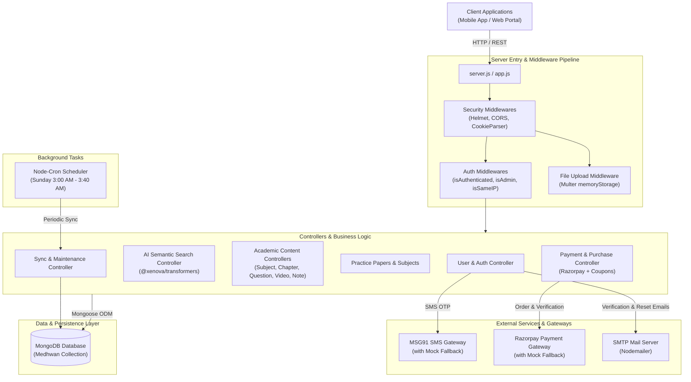
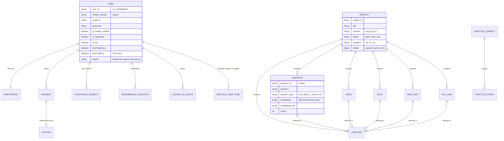
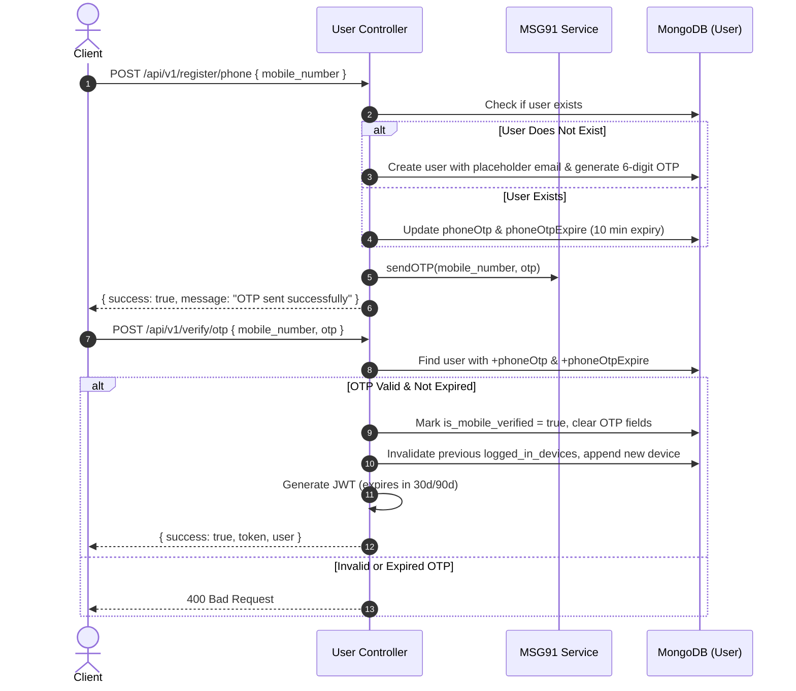
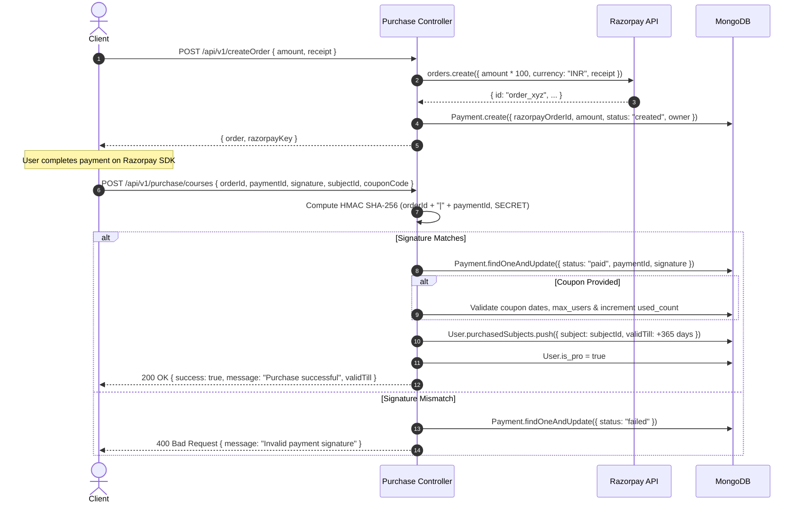
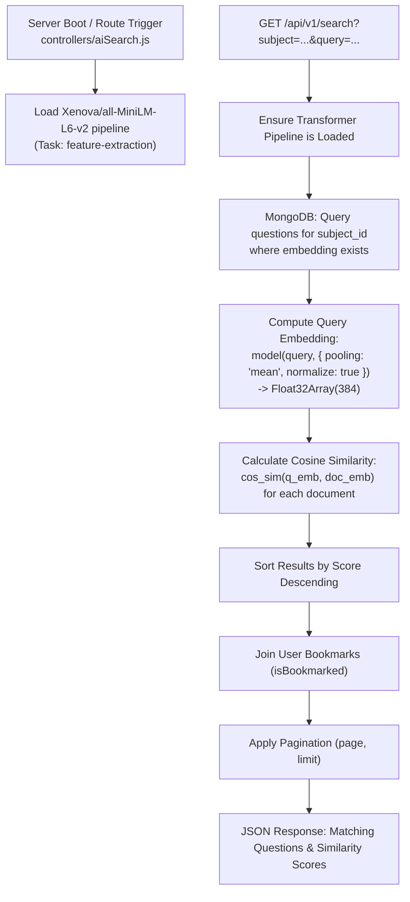

# Prajwal Backend — Architecture Documentation

This document provides a comprehensive technical overview of the **Prajwal Backend** codebase (Medhwan / Prajwal EdTech Platform). It details the architectural paradigms, technology stack, directory layout, domain models, end-to-end request pipelines, external service integrations, and operational maintenance jobs.

---

## 1. System Overview & Context

**Prajwal** is an educational technology backend designed to support Indian school curricula across educational boards (such as GSEB, CBSE, and ICSE), mediums (English, Gujarati, Hindi), and standard grades (Grades 1–12).

### Core Functional Capabilities:
- **Authentication & User Management**: Multi-factor identity validation supporting Phone OTP (MSG91), Email/Password, Email verification links, Device session tracking, and IP subnet anomaly checks.
- **Academic Content Hierarchy**: Subjects $\rightarrow$ Chapters $\rightarrow$ Educational Assets (Questions, Videos, Notes, Mind Maps, Hotlines, Practice Papers).
- **Embedded AI & Semantic Search**: In-process inference using local Transformers (`@xenova/transformers` with `all-MiniLM-L6-v2`) computing 384-dimensional dense vectors and cosine similarities for semantic question retrieval.
- **Monetization & Commercials**: Razorpay order management, HMAC-SHA256 signature verification, 1-year subject licenses, dynamic coupon discounts, and a 120-hour free-trial anti-abuse tracking system.
- **Background Maintenance**: Automated scheduled routines (`node-cron`) to maintain relational integrity, synchronize subject counters, clean temporary storage, and prune orphaned data.

---

## 2. Technology Stack

| Layer | Technologies / Packages | Purpose |
|---|---|---|
| **Runtime & Framework** | Node.js (CommonJS), Express.js 4.19 | HTTP server, REST routing, middleware orchestration |
| **Database & ODM** | MongoDB, Mongoose 8.5 | Schematized data storage, indexing, lifecycle hooks |
| **Local Machine Learning** | `@xenova/transformers` (`all-MiniLM-L6-v2`) | In-memory text embeddings generation without external API dependencies |
| **Security & Cryptography** | `jsonwebtoken`, `bcrypt`, `helmet`, `cors`, `crypto` | JWT tokens, password hashing, security headers, HMAC verification |
| **Payment Gateway** | Razorpay SDK (`razorpay`) | Order generation, digital payments, webhook validation |
| **Communication / Messaging** | `msg91` (SMS OTP), `nodemailer` (SMTP) | Phone OTP delivery, email verification, job application alerts |
| **File & Media Handling** | `multer` (memoryStorage) | JSON file uploads, resume handling |
| **Job Scheduling** | `node-cron` | Cron-based background synchronization |
| **Environment & Tooling** | `dotenv`, `nodemon`, bash deployment scripts | Configuration management and local execution |

---

## 3. High-Level Architectural Diagram



---

## 4. Directory & Module Structure

```
prajwal_backend/
├── app.js                      # Express application setup, middlewares, and route mounting
├── server.js                   # Application entry point: initializes DB and starts HTTP server
├── run.sh                      # Shell deployment script (git pull, port kill, nodemon start)
├── package.json                # Dependencies and run scripts
├── test-db-connection.js       # Standalone diagnostic utility for MongoDB connectivity
│
├── config/                     # Service Configurations & Gateways
│   ├── database.js             # Mongoose connection options, pooling, timeouts & lifecycle
│   ├── msg91.js                # MSG91 SMS OTP service client with mock fallback
│   └── razorpay.js             # Razorpay API client with mock fallback
│
├── controllers/                # Business Logic Handlers
│   ├── aiSearch.js             # Xenova transformers model initialization & cosine vector search
│   ├── chapter.js              # Chapter CRUD operations
│   ├── connect.js              # Hiring/job application contact form handler
│   ├── coupon.js               # Coupon creation, validation, and usage tracking
│   ├── course.js               # Course bundle management
│   ├── hotLine.js              # Hotline content controller
│   ├── message.js              # Noticeboard / broadcast message operations
│   ├── mindMap.js              # Mind map educational assets
│   ├── note.js                 # Revision notes controller
│   ├── payment.js              # Legacy / direct payment handling
│   ├── practicePaper.js        # Practice test papers
│   ├── practiceSubject.js      # Practice subjects grouping
│   ├── preference.js           # User learning preferences (board, medium, standard)
│   ├── purchase.js             # Razorpay order generation and subject license activation
│   ├── question.js             # Question CRUD, batch JSON upload, and paginated queries
│   ├── subject.js              # Subject management and user created-subject references
│   ├── sync.js                 # Database reconciliation routines (counts, bookmarks, cleanup)
│   ├── user.js                 # Authentication, OTP, profile, devices, trials, bookmarks
│   └── video.js                # Video lesson URLs and metadata
│
├── middlewares/                # Express Middlewares
│   ├── auth.js                 # JWT verification (isAuthenticated, isLoggedIn), isAdmin, isSameIP
│   ├── fileUpload.js           # In-memory multer middleware for JSON file uploads
│   └── sendEmail.js            # Nodemailer transport wrapper for automated emails
│
├── models/                     # Mongoose Schemas & Lifecycle Hooks
│   ├── chapter.js              # Chapter schema
│   ├── coupon.js               # Promotional discount coupons
│   ├── course.js               # Course model
│   ├── deletedUserTrial.js     # Deleted account free-trial history to prevent trial reuse
│   ├── hotLine.js              # Hotline schema
│   ├── message.js              # Notice/bulletin messages
│   ├── mindMap.js              # Visual mind map schemas
│   ├── note.js                 # Study note schema
│   ├── payment.js              # Razorpay payment orders and receipts
│   ├── practice_subjects.js    # Practice subject model
│   ├── practicePaper.js        # PDF / link practice papers
│   ├── preference.js           # User educational preferences (board, medium, standard)
│   ├── question.js             # Question schema (includes 384-dim vector embeddings)
│   ├── subject.js              # Academic subjects with question-type counters
│   ├── user.js                 # Core user schema with pre/post hooks and helper methods
│   └── video.js                # Video content schema
│
├── routes/                     # REST API Endpoint Definitions
│   ├── chapter.js              # /api/v1/chapter
│   ├── connect.js              # /api/v1/connect
│   ├── coupon.js               # /api/v1/coupon
│   ├── hotLine.js              # /api/v1/hot-line
│   ├── message.js              # /api/v1/message
│   ├── mindMap.js              # /api/v1/mind-map
│   ├── note.js                 # /api/v1/note
│   ├── payment.js              # /api/v1/payment
│   ├── practicePaper.js        # /api/v1/practice-papers
│   ├── practiceSubject.js      # /api/v1/practice-subjects
│   ├── preference.js           # /api/v1/preferences
│   ├── purchase.js             # /api/v1/purchase
│   ├── question.js             # /api/v1/question
│   ├── search.js               # /api/v1/search & /api/v1/generate-embeddings
│   ├── subject.js              # /api/v1/subject
│   ├── sync.js                 # /api/v1/sync
│   ├── user.js                 # /api/v1/register, login, me, otp, passwords
│   └── video.js                # /api/v1/video
│
├── maintenance/                # Scheduled Cron Tasks
│   └── scheduler.js            # Schedules weekly synchronization & cleanup jobs
│
└── scripts/                    # Offline / Administrative Utilities
    └── generateEmbeddings.js   # Script to generate vector embeddings for all questions
```

---

## 5. Domain Models & Entity Relationships



### Critical Model Mechanisms:
1. **Automated User ID Generation (`models/user.js`)**:
   - A `pre('save')` hook queries the highest serial user for the current calendar year (e.g., `2026000042`) and increments it automatically (`YYYY + 6-digit serial`).
2. **120-Hour Free Trial**:
   - Automatically initializes `freeTrialStart` and sets `freeTrialEnd = Date.now() + 120 hours`.
   - On modification, another hook ensures `freeTrialActive` transitions to `false` once `Date.now() > freeTrialEnd`.
   - When accounts are purged, trial records are saved into `DeletedUserTrial` to prevent re-registering for infinite free access.
3. **Cascading Preferences**:
   - A `post('save')` hook on `User` automatically creates a default `Preference` entry (`board: GSEB`, `medium: ENG`, `standard: 10`, `theme: system`, `language: en`).
4. **IP Subnet Security (`UserIP`)**:
   - The user model tracks `UserIP`. Requests through `isSameIP` match the first three octets of IPv4 (`X.X.X.*`) to prevent account sharing while accommodating minor mobile network changes.

---

## 6. Key Request & Data Flow Pipelines

### 6.1 Authentication Pipeline (Phone OTP & Device Locking)



---

### 6.2 Payment Verification & Course Entitlement



---

### 6.3 Semantic Question Search Engine

Unlike typical search setups that require external services like Pinecone or ElasticSearch, this backend implements an **in-process neural search engine** using `@xenova/transformers`.



#### Cosine Similarity Formula:
$$\text{Cosine Similarity} = \frac{\mathbf{A} \cdot \mathbf{B}}{\|\mathbf{A}\|_2 \|\mathbf{B}\|_2 + 10^{-12}} = \frac{\sum_{i=1}^{384} A_i B_i}{\sqrt{\sum_{i=1}^{384} A_i^2} \sqrt{\sum_{i=1}^{384} B_i^2} + 10^{-12}}$$

---

### 6.4 Scheduled Maintenance & Data Reconciliation

The server initializes an automated cron suite (`maintenance/scheduler.js`) using `node-cron`, executing every Sunday during low-traffic hours:

| Schedule (Cron) | Trigger Time | Action / Target Function | Operational Impact |
|---|---|---|---|
| `0 3 * * 0` | Sun 03:00 AM | `syncCoursesWithQuestions()` | Tallies questions per subject and updates question type statistics (`total_mcq_questions`, `total_2m_questions`, etc.). |
| `10 3 * * 0` | Sun 03:10 AM | `clearUploadsDirectory()` | Purges temporary staging files from the disk storage. |
| `20 3 * * 0` | Sun 03:20 AM | `syncUserBookmarkedQuestions()` | Verifies bookmarked question IDs against existing questions in DB and prunes dangling references. |
| `30 3 * * 0` | Sun 03:30 AM | `clearNonExistingUserPreferences()` | Deletes preference documents whose associated `user` ObjectId no longer exists. |
| `40 3 * * 0` | Sun 03:40 AM | `syncPaidCoursesWithUsers()` | Audits paid course entitlements against active subscriptions. |

---

## 7. Database Resiliency & Optimization

Following earlier connection latency challenges, the repository incorporates specific MongoDB reliability configurations (`config/database.js`):

```javascript
const options = {
  useNewUrlParser: true,
  useUnifiedTopology: true,
  serverSelectionTimeoutMS: 30000, // 30s selection window
  socketTimeoutMS: 45000,          // 45s socket lifetime
  connectTimeoutMS: 30000,         // 30s connection timeout
  maxPoolSize: 10,                 // Pool bounded to 10 connections
  minPoolSize: 1,
  maxIdleTimeMS: 30000,            // Reclaim connections idle > 30s
  retryWrites: true,
  w: "majority",
};
```

### Strategic Indexes:
- **`User` Collection**:
  - `user_id`: 1
  - `mobile_number`: 1 (unique)
  - `email_id`: 1
  - `bookmarked_questions`: 1
  - `UserIP`: 1
- **`Question` Collection**:
  - `question_id`: 1 (unique)
  - `category_id`: 1
  - `subject`: 1
  - `chapter`: 1
- **Individual Operation Timeouts**:
  - Critical lookup operations incorporate `.maxTimeMS(5000)` (e.g. `isAuthenticated` token verification and bookmark modifications) to prevent request thread starvation during query stalls.

---

## 8. REST API Endpoint Catalog

All routes are mounted under the `/api/v1` namespace in `app.js`.

### 8.1 Authentication & User Routes (`routes/user.js`)
| Method | Route | Protection | Description |
|---|---|---|---|
| `GET` | `/api/v1/check-auth` | `isLoggedIn` | Verifies JWT and returns current user session status |
| `POST` | `/api/v1/register` | Public | Standard email/password registration |
| `POST` | `/api/v1/register/phone` | Public | Generates and sends 6-digit phone OTP |
| `POST` | `/api/v1/register/user` | Public | Sets display name for newly created phone user |
| `POST` | `/api/v1/resend/otp` | Public | Re-triggers phone OTP |
| `POST` | `/api/v1/verify/otp` | Public | Verifies OTP, logs into new device, and issues JWT |
| `POST` | `/api/v1/login` | Public | Email and password login |
| `GET` | `/api/v1/logout` | `isAuthenticated` | Clears cookie and session |
| `POST` | `/api/v1/update/password` | `isAuthenticated` | Changes user password |
| `POST` | `/api/v1/update/profile` | `isAuthenticated` | Updates profile name, school, district |
| `DELETE` | `/api/v1/delete/me` | `isAuthenticated` | Purges account and logs trial in `DeletedUserTrial` |
| `GET` | `/api/v1/me` | `isAuthenticated` | Returns authenticated user profile |
| `GET` | `/api/v1/users` | `isAuthenticated` | Lists all users |
| `POST` | `/api/v1/password/forgot` | Public | Generates password reset token |
| `POST` | `/api/v1/password/reset/:token` | Public | Resets password using token |
| `POST` | `/api/v1/bookmark/:id` | `isAuthenticated` | Toggles bookmark for specified question ID |

### 8.2 Academic Content & Curriculum Routes
| Route File | Base Path / Endpoints | Auth Level | Purpose |
|---|---|---|---|
| `subject.js` | `GET /subjects`<br>`POST /subject/create`<br>`GET /subject/:id` | `isAuthenticated` + `isSameIP` | Subjects list, subject metadata, and owner links |
| `chapter.js` | `GET /chapters`<br>`POST /chapter/create`<br>`GET /chapter/:id` | `isAuthenticated` | Chapters within subjects |
| `question.js` | `GET /questions`<br>`POST /question` (Admin)<br>`POST /questions/upload`<br>`GET /question/paginated` | `isAuthenticated` | Question bank, pagination, bulk JSON import |
| `practiceSubject.js` | `GET /practice-subjects`<br>`POST /create/practice-subjects` | Public / Authed | Practice subjects groupings |
| `practicePaper.js` | `GET /practice-papers`<br>`POST /practice-paper`<br>`POST /practice-papers/bulk` | Public / Authed | Practice papers and PDFs |
| `video.js` | `GET /videos`<br>`GET /videos/by-chapter`<br>`POST /video/create` | `isAuthenticated` | Video lessons by chapter and topic |
| `note.js` | `GET /note`<br>`GET /note/by-chapter`<br>`POST /note` | Public / Authed | Study and revision notes |
| `mindMap.js` | `GET /mind-map`<br>`GET /mind-map/by-chapter`<br>`POST /mind-map` | Public / Authed | Visual mind maps |
| `hotLine.js` | `GET /hot-lines`<br>`GET /hot-line/by-chapter`<br>`POST /hot-line` | Public / Authed | Hotline educational content |

### 8.3 AI Search Routes (`routes/search.js`)
| Method | Route | Protection | Description |
|---|---|---|---|
| `GET` | `/api/v1/search` | `isAuthenticated` | Semantic vector search across questions in a subject |
| `POST` | `/api/v1/generate-embeddings` | Public / Internal | Generates dense embeddings for subject questions |

### 8.4 Commercial & Purchases (`routes/purchase.js`, `routes/payment.js`, `routes/coupon.js`)
| Method | Route | Protection | Description |
|---|---|---|---|
| `POST` | `/api/v1/createOrder` | `isAuthenticated` | Initializes Razorpay order and returns `order_id` |
| `POST` | `/api/v1/purchase/courses` | `isAuthenticated` | Verifies payment, applies coupon, activates 1-year subject access |
| `POST` | `/api/v1/createCoupon` | `isAuthenticated` | Creates promotional discount coupon |
| `GET` | `/api/v1/getAllCoupons` | `isAuthenticated` | Lists active coupons |

### 8.5 Operations, Sync & Communication (`routes/sync.js`, `routes/message.js`, `routes/connect.js`)
| Method | Route | Protection | Description |
|---|---|---|---|
| `GET` | `/api/v1/sync/subjects` | `isAdmin` | Syncs question counters with subjects |
| `GET` | `/api/v1/sync/bookmarks` | `isAdmin` | Removes orphaned bookmark references |
| `GET` | `/api/v1/sync/preferences` | `isAdmin` | Cleans orphaned user preference documents |
| `POST` | `/api/v1/message` | Public | Posts system notice/bulletin |
| `GET` | `/api/v1/message/latest` | Public | Retrieves latest system broadcast message |
| `POST` | `/api/v1/connect` | Public (Multer) | Job applicant hiring form (emails resume via SMTP) |

---

## 9. Deployment & Operational Lifecycle

### Deployment Flow via `run.sh`:
The repository provides an automated server restart and maintenance script:
1. **Branch Checkout & Pull**: Fetches and pulls the specified Git branch (`main`).
2. **Dependency Refresh**: Purges `node_modules` and `package-lock.json` and runs clean `npm install`.
3. **Port Conflict Resolution**: Identifies active processes on `PORT` (e.g. 3000) using `lsof -ti:$PORT` and invokes `kill -9` to prevent `EADDRINUSE` errors.
4. **Execution**: Boots the application via `npm run dev` (`nodemon server.js`).

### Graceful Shutdown:
The application hooks into process termination events (`SIGINT` in `config/database.js`) to close active MongoDB connection pools gracefully before exiting.
