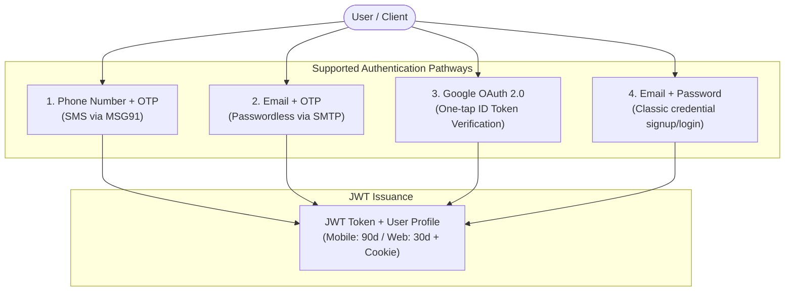
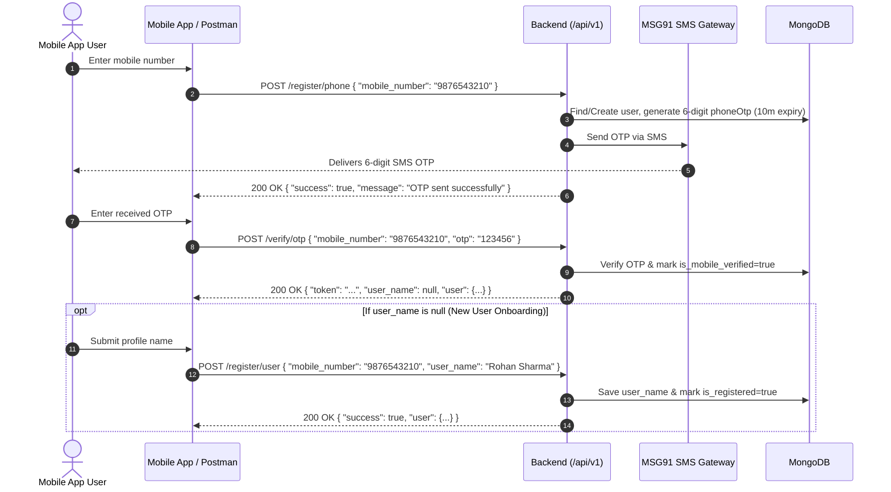

# Prajwal Backend — Complete Authentication & Postman Testing Guide

This document is the dedicated, comprehensive guide for all **Authentication** workflows in the Prajwal Backend. It details all authentication endpoints, request/response structures, and provides a complete step-by-step guide on how to test each flow in **Postman**.

For Authorization, Role-Based Access Control (RBAC), and protected route security, refer to [README.md](file:///home/abhijit_1859/Documents/work-codes/prajwal_backend/README.md).

---

## Table of Contents
1. [Overview & Base Configuration](#1-overview--base-configuration)
2. [Authentication Methods Supported](#2-authentication-methods-supported)
3. [Method 1: Phone Number + OTP Flow (MSG91 SMS)](#3-method-1-phone-number--otp-flow-msg91-sms)
4. [Method 2: Email + OTP Flow (SMTP)](#4-method-2-email--otp-flow-smtp)
5. [Method 3: Google OAuth 2.0 (Mobile & Web)](#5-method-3-google-oauth-20-mobile--web)
6. [Method 4: Email & Password (Classic Flow)](#6-method-4-email--password-classic-flow)
7. [Method 5: Password Recovery & Reset Flow](#7-method-5-password-recovery--reset-flow)
8. [Method 6: Email Verification Link Workflows](#8-method-6-email-verification-link-workflows)
9. [Method 7: Session Verification & Logout](#9-method-7-session-verification--logout)
10. [Comprehensive Postman Testing Guide](#10-comprehensive-postman-testing-guide)
    - [Postman Environment Setup](#postman-environment-setup)
    - [Automated Token Extraction Script](#automated-token-extraction-script)
    - [Step-by-Step Testing Walkthroughs](#step-by-step-testing-walkthroughs)
    - [Importable Postman Collection (v2.1 JSON)](#importable-postman-collection-v21-json)
11. [Troubleshooting & Error Reference](#11-troubleshooting--error-reference)

---

## 1. Overview & Base Configuration

- **Base URL (Local)**: `http://localhost:3000/api/v1`
- **Base URL (Production)**: `https://your-domain.com/api/v1`
- **App Deep Link Scheme**: `medhwan-prajwal://`
- **Tokens Issued**: JSON Web Tokens (JWT) signed with `JWT_SECRET`.
  - **Mobile Token Lifespan**: `90 days` (triggered when header `x-client-type: mobile` is provided).
  - **Web Token Lifespan**: `30 days` (also sets secure HTTP-only cookie `token`).

---

## 2. Authentication Methods Supported



---

## 3. Method 1: Phone Number + OTP Flow (MSG91 SMS)

Used as the primary phone-based login and registration for the mobile application.



### 3.1 Request Phone OTP
- **Endpoint**: `POST /api/v1/register/phone`
- **Headers**:
  ```http
  Content-Type: application/json
  ```
- **Request Body**:
  ```json
  {
    "mobile_number": "9876543210"
  }
  ```
  *(Accepts `"mobile_number"` or `"phoneNumber"`)*
- **Response (200 OK)**:
  ```json
  {
    "success": true,
    "message": "OTP sent successfully"
  }
  ```

---

### 3.2 Verify Phone OTP
- **Endpoint**: `POST /api/v1/verify/otp`
- **Headers**:
  ```http
  Content-Type: application/json
  x-client-type: mobile
  ```
- **Request Body**:
  ```json
  {
    "mobile_number": "9876543210",
    "otp": "123456"
  }
  ```
- **Response (200 OK)**:
  ```json
  {
    "success": true,
    "message": "Phone verified",
    "token": "eyJhbGciOiJIUzI1NiIsInR5cCI6IkpXVCJ9...",
    "user_name": null,
    "user": {
      "_id": "670c2a71d8a34b22c748c101",
      "mobile_number": "9876543210",
      "phoneNumber": "9876543210",
      "is_mobile_verified": true,
      "isPhoneVerified": true,
      "freeTrialActive": true,
      "role": "user"
    }
  }
  ```
  *(Note: If `user_name` is `null`, client must prompt user for name in Step 3.3).*

---

### 3.3 Set Profile Name (New User Onboarding)
- **Endpoint**: `POST /api/v1/register/user`
- **Headers**:
  ```http
  Content-Type: application/json
  ```
- **Request Body**:
  ```json
  {
    "mobile_number": "9876543210",
    "user_name": "Rohan Sharma"
  }
  ```
- **Response (200 OK)**:
  ```json
  {
    "success": true,
    "message": "User name saved successfully",
    "user": {
      "_id": "670c2a71d8a34b22c748c101",
      "user_name": "Rohan Sharma",
      "name": "Rohan Sharma",
      "is_registered": true
    }
  }
  ```

---

### 3.4 Resend Phone OTP
- **Endpoint**: `POST /api/v1/resend/otp`
- **Headers**:
  ```http
  Content-Type: application/json
  ```
- **Request Body**:
  ```json
  {
    "mobile_number": "9876543210"
  }
  ```
- **Response (200 OK)**:
  ```json
  {
    "success": true,
    "message": "OTP resent successfully"
  }
  ```

---

## 4. Method 2: Email + OTP Flow (SMTP)

Passwordless email authentication delivering a 6-digit OTP code to the user's inbox.

### 4.1 Request Email OTP
- **Endpoint**: `POST /api/v1/register/email` *(or alias `POST /api/v1/send/email/otp`)*
- **Headers**:
  ```http
  Content-Type: application/json
  ```
- **Request Body**:
  ```json
  {
    "email": "student@example.com"
  }
  ```
  *(Accepts `"email"` or `"email_id"`)*
- **Response (200 OK)**:
  ```json
  {
    "success": true,
    "message": "Email verification OTP sent successfully"
  }
  ```

---

### 4.2 Verify Email OTP
- **Endpoint**: `POST /api/v1/verify/otp`
- **Headers**:
  ```http
  Content-Type: application/json
  x-client-type: mobile
  ```
- **Request Body**:
  ```json
  {
    "email": "student@example.com",
    "otp": "654321"
  }
  ```
- **Response (200 OK)**:
  ```json
  {
    "success": true,
    "message": "Phone verified",
    "token": "eyJhbGciOiJIUzI1NiIsInR5cCI6IkpXVCJ9...",
    "user_name": "student",
    "user": {
      "_id": "670c3841d8a34b22c748c109",
      "email": "student@example.com",
      "email_id": "student@example.com",
      "is_email_verified": true,
      "isEmailVerified": true,
      "freeTrialActive": true,
      "role": "user"
    }
  }
  ```

---

### 4.3 Resend Email OTP
- **Endpoint**: `POST /api/v1/resend/otp`
- **Headers**:
  ```http
  Content-Type: application/json
  ```
- **Request Body**:
  ```json
  {
    "email": "student@example.com"
  }
  ```
- **Response (200 OK)**:
  ```json
  {
    "success": true,
    "message": "OTP resent successfully"
  }
  ```

---

## 5. Method 3: Google OAuth 2.0 (Mobile & Web)

One-tap sign-in using Google ID Token verification against Google Cloud APIs. Handled in [`controllers/auth.js`](file:///home/abhijit_1859/Documents/work-codes/prajwal_backend/controllers/auth.js).

### Endpoints
- `POST /api/v1/google/login`
- `POST /api/v1/login/google` *(alias)*

### Headers
```http
Content-Type: application/json
x-client-type: mobile
currentip: 192.168.1.105
```
*(Note: If `x-client-type: mobile` is provided, `deviceId` and `deviceName` are mandatory).*

### Request Body (Mobile)
```json
{
  "idToken": "eyJhbGciOiJSUzI1NiIsImtpZCI6Ij...",
  "deviceId": "samsung-sm-g991b-uuid",
  "deviceName": "Samsung Galaxy S21"
}
```
*(Accepts `"idToken"`, `"token"`, or `"credential"`)*

### Request Body (Web)
```json
{
  "idToken": "eyJhbGciOiJSUzI1NiIsImtpZCI6Ij..."
}
```

### Response (200 OK)
```json
{
  "success": true,
  "user": {
    "_id": "670c32b5d8a34b22c748c105",
    "email": "student@gmail.com",
    "name": "Jane Doe",
    "user_name": "Jane Doe",
    "googleId": "109876543210987654321",
    "imageUrl": "https://lh3.googleusercontent.com/a/...",
    "isEmailVerified": true,
    "is_registered": true,
    "freeTrialActive": true,
    "role": "user"
  },
  "token": "eyJhbGciOiJIUzI1NiIsInR5cCI6IkpXVCJ9...",
  "ipUpdated": true
}
```

---

## 6. Method 4: Email & Password (Classic Flow)

Standard email and password registration and login flow with email activation requirements.

### 6.1 Register with Email & Password
- **Endpoint**: `POST /api/v1/register`
- **Headers**:
  ```http
  Content-Type: application/json
  x-intent-name: medhwan-prajwal
  ```
  *(Supported `x-intent-name` values: `medhwan-prajwal`, `medhwan-uttam`)*
- **Request Body**:
  ```json
  {
    "name": "Aarav Patel",
    "email": "aarav@example.com",
    "password": "Password123!",
    "mobile_number": "9876543211",
    "school": "Delhi Public School",
    "organization": "GSEB",
    "district": "Ahmedabad"
  }
  ```
- **Response (201 Created)**:
  ```json
  {
    "success": true,
    "message": "Verification email sent to aarav@example.com. Please verify your email.",
    "user": {
      "_id": "670c4001d8a34b22c748c120",
      "name": "Aarav Patel",
      "email": "aarav@example.com",
      "isEmailVerified": false,
      "role": "user"
    }
  }
  ```

---

### 6.2 Login with Email & Password
- **Endpoint**: `POST /api/v1/login`
- **Headers**:
  ```http
  Content-Type: application/json
  x-client-type: mobile
  currentip: 192.168.1.100
  ```
- **Request Body (Mobile)**:
  ```json
  {
    "email": "aarav@example.com",
    "password": "Password123!",
    "deviceId": "pixel-7-device-id-9988",
    "deviceName": "Google Pixel 7"
  }
  ```
- **Request Body (Web)**:
  ```json
  {
    "email": "aarav@example.com",
    "password": "Password123!"
  }
  ```
- **Response (200 OK)**:
  ```json
  {
    "success": true,
    "user": {
      "_id": "670c4001d8a34b22c748c120",
      "name": "Aarav Patel",
      "email": "aarav@example.com",
      "role": "user",
      "isEmailVerified": true
    },
    "token": "eyJhbGciOiJIUzI1NiIsInR5cCI6IkpXVCJ9...",
    "ipUpdated": true
  }
  ```

---

## 7. Method 5: Password Recovery & Reset Flow

### 7.1 Forgot Password (Request Reset Link)
- **Endpoint**: `POST /api/v1/password/forgot` *(or `/api/v1/password/forgot/prajjwal`)*
- **Headers**:
  ```http
  Content-Type: application/json
  ```
- **Request Body**:
  ```json
  {
    "email": "aarav@example.com"
  }
  ```
- **Response (200 OK)**:
  ```json
  {
    "success": true,
    "message": "Email sent to aarav@example.com"
  }
  ```

---

### 7.2 Render Password Reset Web Page
- **Endpoint**: `GET /api/v1/password/reset/prajjwal/:token`
- **Description**: Renders HTML reset page for users clicking link in email.
- **Response**: HTML form page.

---

### 7.3 Submit Password Reset
- **Endpoint**: `POST /api/v1/password/reset/:token`
- **Headers**:
  ```http
  Content-Type: application/json
  ```
- **Request Body**:
  ```json
  {
    "password": "NewStrongPassword123!"
  }
  ```
- **Response (200 OK)**:
  ```json
  {
    "success": true,
    "message": "Password updated successfully"
  }
  ```

---

### 7.4 Update Password (Logged-In User)
- **Endpoint**: `POST /api/v1/update/password`
- **Headers**:
  ```http
  Content-Type: application/json
  Authorization: Bearer <YOUR_JWT_TOKEN>
  ```
- **Request Body**:
  ```json
  {
    "oldPassword": "OldPassword123!",
    "newPassword": "NewStrongPassword123!"
  }
  ```
- **Response (200 OK)**:
  ```json
  {
    "success": true,
    "message": "Password updated successfully"
  }
  ```

---

## 8. Method 6: Email Verification Link Workflows

Used when a user registers with Email + Password and must click a link sent via email.

### 8.1 Verify Email via Token Link
- **Endpoints**:
  - `GET /api/v1/verify/email/:token` (Standard redirect)
  - `GET /api/v1/verify/email/prajjwal/:token` (Prajwal app redirect to `medhwan-prajwal://`)
  - `GET /api/v1/verify/email/uttam/:token` (Uttam app redirect)
- **Response**:
  - `200 OK` (Web message) or `302 Redirect` to mobile deep link scheme.

---

### 8.2 Resend Verification Email
- **Endpoint**: `POST /api/v1/resend/verification/email` *(alias `/api/v1/resend/verification-email`)*
- **Headers**:
  ```http
  Content-Type: application/json
  x-intent-name: medhwan-prajwal
  ```
- **Request Body**:
  ```json
  {
    "email": "aarav@example.com"
  }
  ```
- **Response (200 OK)**:
  ```json
  {
    "success": true,
    "message": "Verification email sent successfully"
  }
  ```

---

## 9. Method 7: Session Verification & Logout

### 9.1 Check Auth Session
Verifies if saved JWT token in client storage is still valid upon app startup or resume.
- **Endpoint**: `GET /api/v1/check-auth`
- **Headers**:
  ```http
  Authorization: Bearer <YOUR_JWT_TOKEN>
  ```
- **Response (200 OK)**:
  ```json
  {
    "success": true,
    "user": {
      "_id": "670c4001d8a34b22c748c120",
      "name": "Aarav Patel",
      "email": "aarav@example.com",
      "role": "user"
    }
  }
  ```
- **Error (401 Unauthorized)**:
  ```json
  {
    "success": false,
    "message": "Invalid or expired token"
  }
  ```

---

### 9.2 Logout
Clears cookie and terminates the user session.
- **Endpoint**: `POST /api/v1/logout` *(or `GET /api/v1/logout`)*
- **Headers**:
  ```http
  Authorization: Bearer <YOUR_JWT_TOKEN>
  ```
- **Response (200 OK)**:
  ```json
  {
    "success": true,
    "message": "Logged out successfully"
  }
  ```

---

## 10. Comprehensive Postman Testing Guide

Follow this guide to set up a professional Postman testing environment for the authentication APIs.

### Postman Environment Setup

1. In Postman, open **Environments** $\rightarrow$ Click **Create Environment** (name it `Prajwal Local`).
2. Add the following variables:

| Variable | Initial Value | Current Value | Description |
|---|---|---|---|
| `base_url` | `http://localhost:3000/api/v1` | `http://localhost:3000/api/v1` | Backend root URL |
| `jwt_token` | *(leave blank)* | *(auto-set by test scripts)* | Active bearer token |
| `phone_number` | `9876543210` | `9876543210` | Test mobile number |
| `test_email` | `test.student@example.com` | `test.student@example.com` | Test email address |
| `test_password`| `Password123!` | `Password123!` | Test password |
| `device_id` | `postman-device-001` | `postman-device-001` | Mobile device identifier |
| `device_name` | `Postman Agent` | `Postman Agent` | Mobile device model name |
| `current_ip` | `192.168.1.50` | `192.168.1.50` | Test IP address |

3. Select `Prajwal Local` from the environment dropdown in the top right.

---

### Automated Token Extraction Script

Add this snippet to the **Tests** tab of your login/verification requests (`POST /verify/otp`, `POST /login`, `POST /google/login`):

```javascript
// Check status is 200 OK
pm.test("Status code is 200", function () {
    pm.response.to.have.status(200);
});

// Extract token and save to environment variable automatically
const responseData = pm.response.json();
if (responseData.success && responseData.token) {
    pm.environment.set("jwt_token", responseData.token);
    console.log("JWT Token captured and saved to environment: " + responseData.token);
}

// Optionally save user ID
if (responseData.user && responseData.user._id) {
    pm.environment.set("user_id", responseData.user._id);
}
```

---

### Step-by-Step Testing Walkthroughs

#### Test Flow A: Phone + OTP Verification (Standard Mobile Sign-in)
1. **Send OTP**:
   - Method: `POST`
   - URL: `{{base_url}}/register/phone`
   - Body (`raw` JSON):
     ```json
     {
       "mobile_number": "{{phone_number}}"
     }
     ```
   - Send and verify response is `{ "success": true, "message": "OTP sent successfully" }`.

2. **Verify OTP**:
   - In development, check your backend console logs for the generated 6-digit OTP (e.g. `123456`).
   - Method: `POST`
   - URL: `{{base_url}}/verify/otp`
   - Headers:
     - `Content-Type`: `application/json`
     - `x-client-type`: `mobile`
   - Body (`raw` JSON):
     ```json
     {
       "mobile_number": "{{phone_number}}",
       "otp": "123456"
     }
     ```
   - Send request. The test script will automatically capture `jwt_token`.

3. **Complete Name Registration (If New User)**:
   - Method: `POST`
   - URL: `{{base_url}}/register/user`
   - Body (`raw` JSON):
     ```json
     {
       "mobile_number": "{{phone_number}}",
       "user_name": "Rohan Sharma"
     }
     ```
   - Send and verify profile is saved.

---

#### Test Flow B: Email + Password Login
1. **Login Request**:
   - Method: `POST`
   - URL: `{{base_url}}/login`
   - Headers:
     - `Content-Type`: `application/json`
     - `x-client-type`: `mobile`
     - `currentip`: `{{current_ip}}`
   - Body (`raw` JSON):
     ```json
     {
       "email": "{{test_email}}",
       "password": "{{test_password}}",
       "deviceId": "{{device_id}}",
       "deviceName": "{{device_name}}"
     }
     ```
   - Send request. Verify token is received and automatically saved.

---

#### Test Flow C: Session Check & Logout
1. **Check Auth Status**:
   - Method: `GET`
   - URL: `{{base_url}}/check-auth`
   - Headers:
     - `Authorization`: `Bearer {{jwt_token}}`
   - Send and confirm user profile returns `200 OK`.

2. **Logout**:
   - Method: `POST`
   - URL: `{{base_url}}/logout`
   - Headers:
     - `Authorization`: `Bearer {{jwt_token}}`
   - Send and confirm `Logged out successfully`.

---

### Importable Postman Collection (v2.1 JSON)

Copy the JSON snippet below, open Postman $\rightarrow$ click **Import** $\rightarrow$ paste into raw text to load all authentication endpoints instantly:

```json
{
  "info": {
    "name": "Prajwal Backend — Authentication Suite",
    "description": "Complete authentication collection for Prajwal Backend including OTP, Google OAuth, and password management.",
    "schema": "https://schema.getpostman.com/json/collection/v2.1.0/collection.json"
  },
  "item": [
    {
      "name": "1. Phone OTP Auth",
      "item": [
        {
          "name": "1.1 Send Phone OTP",
          "request": {
            "method": "POST",
            "header": [
              { "key": "Content-Type", "value": "application/json" }
            ],
            "body": {
              "mode": "raw",
              "raw": "{\n  \"mobile_number\": \"{{phone_number}}\"\n}"
            },
            "url": "{{base_url}}/register/phone"
          }
        },
        {
          "name": "1.2 Verify Phone OTP",
          "event": [
            {
              "listen": "test",
              "script": {
                "exec": [
                  "const res = pm.response.json();",
                  "if (res.token) {",
                  "    pm.environment.set('jwt_token', res.token);",
                  "    pm.test('Token saved', () => pm.expect(res.token).to.be.a('string'));",
                  "}"
                ],
                "type": "text/javascript"
              }
            }
          ],
          "request": {
            "method": "POST",
            "header": [
              { "key": "Content-Type", "value": "application/json" },
              { "key": "x-client-type", "value": "mobile" }
            ],
            "body": {
              "mode": "raw",
              "raw": "{\n  \"mobile_number\": \"{{phone_number}}\",\n  \"otp\": \"123456\"\n}"
            },
            "url": "{{base_url}}/verify/otp"
          }
        },
        {
          "name": "1.3 Register Profile Name",
          "request": {
            "method": "POST",
            "header": [
              { "key": "Content-Type", "value": "application/json" }
            ],
            "body": {
              "mode": "raw",
              "raw": "{\n  \"mobile_number\": \"{{phone_number}}\",\n  \"user_name\": \"Rohan Sharma\"\n}"
            },
            "url": "{{base_url}}/register/user"
          }
        },
        {
          "name": "1.4 Resend Phone OTP",
          "request": {
            "method": "POST",
            "header": [
              { "key": "Content-Type", "value": "application/json" }
            ],
            "body": {
              "mode": "raw",
              "raw": "{\n  \"mobile_number\": \"{{phone_number}}\"\n}"
            },
            "url": "{{base_url}}/resend/otp"
          }
        }
      ]
    },
    {
      "name": "2. Email OTP Auth",
      "item": [
        {
          "name": "2.1 Send Email OTP",
          "request": {
            "method": "POST",
            "header": [
              { "key": "Content-Type", "value": "application/json" }
            ],
            "body": {
              "mode": "raw",
              "raw": "{\n  \"email\": \"{{test_email}}\"\n}"
            },
            "url": "{{base_url}}/register/email"
          }
        },
        {
          "name": "2.2 Verify Email OTP",
          "event": [
            {
              "listen": "test",
              "script": {
                "exec": [
                  "const res = pm.response.json();",
                  "if (res.token) {",
                  "    pm.environment.set('jwt_token', res.token);",
                  "}"
                ],
                "type": "text/javascript"
              }
            }
          ],
          "request": {
            "method": "POST",
            "header": [
              { "key": "Content-Type", "value": "application/json" },
              { "key": "x-client-type", "value": "mobile" }
            ],
            "body": {
              "mode": "raw",
              "raw": "{\n  \"email\": \"{{test_email}}\",\n  \"otp\": \"654321\"\n}"
            },
            "url": "{{base_url}}/verify/otp"
          }
        },
        {
          "name": "2.3 Resend Email OTP",
          "request": {
            "method": "POST",
            "header": [
              { "key": "Content-Type", "value": "application/json" }
            ],
            "body": {
              "mode": "raw",
              "raw": "{\n  \"email\": \"{{test_email}}\"\n}"
            },
            "url": "{{base_url}}/resend/otp"
          }
        }
      ]
    },
    {
      "name": "3. Google OAuth Login",
      "item": [
        {
          "name": "3.1 Google Sign-In",
          "event": [
            {
              "listen": "test",
              "script": {
                "exec": [
                  "const res = pm.response.json();",
                  "if (res.token) {",
                  "    pm.environment.set('jwt_token', res.token);",
                  "}"
                ],
                "type": "text/javascript"
              }
            }
          ],
          "request": {
            "method": "POST",
            "header": [
              { "key": "Content-Type", "value": "application/json" },
              { "key": "x-client-type", "value": "mobile" }
            ],
            "body": {
              "mode": "raw",
              "raw": "{\n  \"idToken\": \"SAMPLE_GOOGLE_ID_TOKEN\",\n  \"deviceId\": \"{{device_id}}\",\n  \"deviceName\": \"{{device_name}}\"\n}"
            },
            "url": "{{base_url}}/google/login"
          }
        }
      ]
    },
    {
      "name": "4. Email & Password",
      "item": [
        {
          "name": "4.1 Register User",
          "request": {
            "method": "POST",
            "header": [
              { "key": "Content-Type", "value": "application/json" },
              { "key": "x-intent-name", "value": "medhwan-prajwal" }
            ],
            "body": {
              "mode": "raw",
              "raw": "{\n  \"name\": \"Test Student\",\n  \"email\": \"{{test_email}}\",\n  \"password\": \"{{test_password}}\",\n  \"mobile_number\": \"{{phone_number}}\"\n}"
            },
            "url": "{{base_url}}/register"
          }
        },
        {
          "name": "4.2 Login",
          "event": [
            {
              "listen": "test",
              "script": {
                "exec": [
                  "const res = pm.response.json();",
                  "if (res.token) {",
                  "    pm.environment.set('jwt_token', res.token);",
                  "}"
                ],
                "type": "text/javascript"
              }
            }
          ],
          "request": {
            "method": "POST",
            "header": [
              { "key": "Content-Type", "value": "application/json" },
              { "key": "x-client-type", "value": "mobile" }
            ],
            "body": {
              "mode": "raw",
              "raw": "{\n  \"email\": \"{{test_email}}\",\n  \"password\": \"{{test_password}}\",\n  \"deviceId\": \"{{device_id}}\",\n  \"deviceName\": \"{{device_name}}\"\n}"
            },
            "url": "{{base_url}}/login"
          }
        }
      ]
    },
    {
      "name": "5. Session Management",
      "item": [
        {
          "name": "5.1 Check Auth Session",
          "request": {
            "method": "GET",
            "header": [
              { "key": "Authorization", "value": "Bearer {{jwt_token}}" }
            ],
            "url": "{{base_url}}/check-auth"
          }
        },
        {
          "name": "5.2 Logout",
          "request": {
            "method": "POST",
            "header": [
              { "key": "Authorization", "value": "Bearer {{jwt_token}}" }
            ],
            "url": "{{base_url}}/logout"
          }
        }
      ]
    }
  ]
}
```

---

## 11. Troubleshooting & Error Reference

| Status Code | Message | Cause & Fix |
|---|---|---|
| `400 Bad Request` | `mobile_number is required` | Ensure request body has `"mobile_number"` or `"phoneNumber"`. |
| `400 Bad Request` | `Invalid OTP` | The submitted 6-digit OTP does not match the generated code in database. |
| `400 Bad Request` | `Expired OTP` | The OTP was sent more than 10 minutes ago. Call `/api/v1/resend/otp`. |
| `400 Bad Request` | `Please provide deviceId and deviceName` | When `x-client-type: mobile` is passed in headers, `deviceId` and `deviceName` are required. |
| `400 Bad Request` | `Please Verify Your Email First` | For password login, email must be verified first via activation link or OTP. |
| `401 Unauthorized` | `Invalid or expired Google ID token` | The Google `idToken` has expired or the `GOOGLE_CLIENT_ID` in `.env` does not match the token's audience. |
| `401 Unauthorized` | `Invalid or expired token` | The Bearer JWT token in the `Authorization` header is invalid or has expired. |
| `500 Internal Server Error` | `Failed to send OTP` | Check `MSG91_AUTH_KEY` or `SMTP_PASS` in `.env`. Ensure outgoing SMS/mail credentials are valid. |

---

> [!TIP]
> For questions regarding route permissions, roles (`user` vs `admin`), and IP subnet verification, check out [README.md](file:///home/abhijit_1859/Documents/work-codes/prajwal_backend/README.md).
