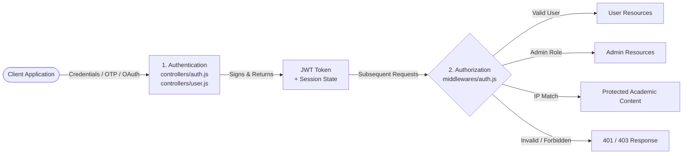
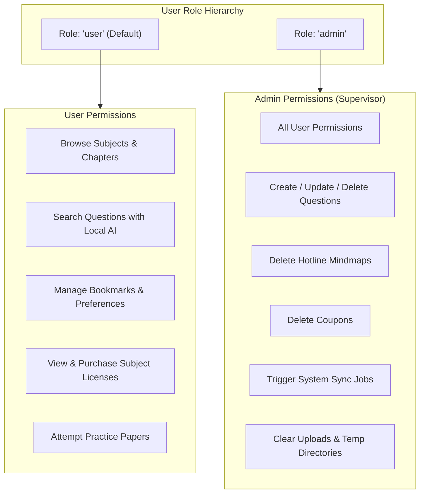
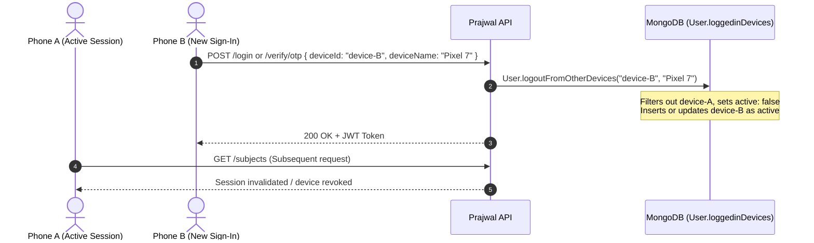

# Prajwal Backend — System & Authorization Architecture

Welcome to the **Prajwal Backend** repository. Prajwal (by Medhwan EdTech) is a modular Node.js/Express REST API serving Indian school curricula across educational boards (GSEB, CBSE, ICSE), mediums, and standards (Grades 1–12).

This document serves as the primary technical specification for the project, with an emphasis on **Authorization, Security Policies, Role-Based Access Control (RBAC), Device Session Management, and the Complete Route Security Matrix**.

> [!NOTE]
> **Looking for Authentication & Postman Testing?**
> All authentication mechanisms (Phone OTP, Email OTP, Google OAuth 2.0, Password Signup/Login, and step-by-step Postman testing with an importable collection) are documented in [AUTHENTICATION.md](file:///home/abhijit_1859/Documents/work-codes/prajwal_backend/AUTHENTICATION.md).

---

## Table of Contents
1. [Authentication vs Authorization](#1-authentication-vs-authorization)
2. [Token Architecture & Security Strategy](#2-token-architecture--security-strategy)
3. [Role-Based Access Control (RBAC)](#3-role-based-access-control-rbac)
4. [Authorization Middlewares](#4-authorization-middlewares)
   - [isLoggedIn](#41-isloggedin)
   - [isAuthenticated](#42-isauthenticated)
   - [isAdmin](#43-isadmin)
   - [isSameIP](#44-issameip)
5. [Device Session & Multi-Device Control](#5-device-session--multi-device-control)
6. [Subscription & Entitlement Authorization](#6-subscription--entitlement-authorization)
7. [Comprehensive Route Authorization Matrix](#7-comprehensive-route-authorization-matrix)
8. [Testing Authorization in Postman & cURL](#8-testing-authorization-in-postman--curl)
9. [Quick Start & Local Setup](#9-quick-start--local-setup)
10. [Documentation Index](#10-documentation-index)

---

## 1. Authentication vs Authorization

The Prajwal backend draws a strict boundary between identity verification and permission enforcement:



- **Authentication (AuthN)**: Identifies *who* the caller is (Phone + OTP, Email + OTP, Google OAuth, or Email + Password). Handled by [`controllers/auth.js`](file:///home/abhijit_1859/Documents/work-codes/prajwal_backend/controllers/auth.js) and [`controllers/user.js`](file:///home/abhijit_1859/Documents/work-codes/prajwal_backend/controllers/user.js).
- **Authorization (AuthZ)**: Dictates *what* the caller is permitted to do based on their role (`user` vs `admin`), network subnet, active mobile device, and subscription status. Handled by [`middlewares/auth.js`](file:///home/abhijit_1859/Documents/work-codes/prajwal_backend/middlewares/auth.js) and model methods in [`models/user.js`](file:///home/abhijit_1859/Documents/work-codes/prajwal_backend/models/user.js).

---

## 2. Token Architecture & Security Strategy

Prajwal issues JSON Web Tokens (JWT) signed using HMAC-SHA256 with the secret stored in `JWT_SECRET`.

### Token Payload
```json
{
  "id": "670c2a71d8a34b22c748c101",
  "iat": 1728900000,
  "exp": 1736676000
}
```

### Client-Type Differentiated Expiration
The token lifespan adapts dynamically to the calling client platform via the `x-client-type` request header:

| Client Type Header | Issued Expiration | Storage & Delivery Mechanism | Rationale |
|---|---|---|---|
| `x-client-type: mobile` | **90 days** | JSON payload (`token`), stored in Secure Keystore / Keychain | Native mobile apps expect long-lived biometric/persistent sessions without frequent re-authentications. |
| Default / Web | **30 days** | Set via HTTP-Only, SameSite cookie (`token`) + JSON response | Web browsers require protection against Cross-Site Scripting (XSS) while maintaining sensible session longevity. |

### Token Extraction Hierarchy
The authorization middleware checks for credentials in the following order:
1. `Authorization: Bearer <token>` header
2. Raw `Authorization: <token>` header
3. `token` cookie via `cookie-parser`

---

## 3. Role-Based Access Control (RBAC)

The application enforces two primary user roles defined in [`models/user.js`](file:///home/abhijit_1859/Documents/work-codes/prajwal_backend/models/user.js):



### Role Summary

| Role | Default Status | Scope & Privileges |
|---|---|---|
| `user` | Assigned to all registrations | Read-only access to academic content; read/write access to own profile, preferences, bookmarks, and Razorpay orders. |
| `admin` | Explicitly granted in database | Full CRUD access to question banks, coupon management, hotline items, and system maintenance cron sync triggers. |

---

## 4. Authorization Middlewares

All authorization guards reside in [`middlewares/auth.js`](file:///home/abhijit_1859/Documents/work-codes/prajwal_backend/middlewares/auth.js).

### 4.1 `isLoggedIn`
Lightweight session check designed for low-latency ping endpoints like `/api/v1/check-auth`.
- **Mechanism**: Verifies the JWT signature with `jwt.verify` without querying MongoDB.
- **Attaches**: `req.user = { id, _id }`.
- **Response on Failure**:
  ```json
  { "success": false, "message": "No token provided" } // 401
  { "success": false, "message": "Invalid or expired token" } // 401
  ```

---

### 4.2 `isAuthenticated`
The primary authorization barrier protecting personal and content routes.
- **Mechanism**:
  1. Decodes and verifies the JWT token.
  2. Executes `User.findById(decoded.id).maxTimeMS(5000)` with a **5-second timeout guard** to prevent MongoDB connection pooling lockups.
  3. Validates that the user record still exists in the database.
- **Attaches**: The full Mongoose `User` document to `req.user`.
- **Error Handling**:
  - `401 Unauthorized`: Missing token, expired token, or user deleted.
  - `408 Request Timeout`: Mongoose query exceeded 5000ms.
  - `500 Internal Server Error`: Unexpected database exceptions.

---

### 4.3 `isAdmin`
Strict Role-Based Access Control gatekeeper.
- **Mechanism**:
  1. Checks if `req.user` is already populated; if not, decodes token and loads user.
  2. Inspects `req.user.role`.
  3. If `req.user.role !== "admin"`, denies access immediately with `403 Forbidden`.
- **Response on Failure**:
  ```json
  {
    "success": false,
    "message": "You are not authorized to access this route"
  }
  ```

---

### 4.4 `isSameIP`
Network subnet binding guard designed to mitigate credential sharing and session hijacking across disparate physical networks.
- **Header**: Inspects `currentip` (or `currentIP`).
- **Mechanism**:
  - Extracts the first three dot-separated octets of the IPv4 address (e.g. `192.168.1.xxx`).
  - Automatically handles IPv4-mapped IPv6 addresses (`::ffff:192.168.1.1`).
  - If the user has no stored IP (first login), the current IP is saved.
  - If the first three octets differ from `user.UserIP`, access is denied:
    ```json
    {
      "success": false,
      "message": "New IP detected. Please verify your identity.",
      "detectedIP": "10.0.0"
    }
    ```

---

## 5. Device Session & Multi-Device Control

To prevent unauthorized multi-device account sharing, the backend implements strict single-device authorization for mobile users:



- **Model Methods** in [`models/user.js`](file:///home/abhijit_1859/Documents/work-codes/prajwal_backend/models/user.js):
  - `logoutFromOtherDevices(newDeviceId, deviceName)`: Purges all other active devices from `loggedinDevices` and records the current timestamp.
  - `logoutFromDevice(deviceId)`: Unregisters a specific device session on logout.
  - `isCurrentDeviceLoggedIn(deviceId)`: Validates if the requesting device holds the authorized active session.

---

## 6. Subscription & Entitlement Authorization

Beyond role validation, access to premium curriculum content requires entitlement authorization:

### 6.1 Free Trial System (120 Hours)
- Every newly created verified user receives a **120-hour (5 days) free trial**:
  ```javascript
  freeTrialStart: new Date(),
  freeTrialEnd: new Date(Date.now() + 120 * 60 * 60 * 1000)
  ```
- **Lifecycle Hook**: A `pre("save")` hook automatically flips `freeTrialActive = false` if `Date.now() > freeTrialEnd`.
- **Anti-Abuse Verification**: If a user deletes their account and later re-registers with the same email, the backend checks [`models/deletedUserTrial.js`](file:///home/abhijit_1859/Documents/work-codes/prajwal_backend/models/deletedUserTrial.js). If previously deleted, `freeTrialActive` is permanently set to `false`, preventing perpetual trial exploits.

### 6.2 Subject License Validation
- Users purchase annual licenses for specific academic subjects via Razorpay.
- Subject licenses are stored in `user.purchasedSubjects`:
  ```json
  {
    "subject": "670c5001d8a34b22c748c150",
    "purchasedAt": "2026-10-14T00:00:00.000Z",
    "validTill": "2027-10-14T00:00:00.000Z"
  }
  ```
- **Helper**: `user.isSubjectValid(subjectId)` evaluates `purchasedSubject.validTill > Date.now()` to grant content authorization.

---

## 7. Comprehensive Route Authorization Matrix

Below is the complete security and authorization mapping for every endpoint registered across the application:

### User & Authentication Routes (`routes/user.js`)

| Method | Endpoint | Authorization Guard | Permitted Roles | Description |
|---|---|---|---|---|
| `GET` | `/api/v1/check-auth` | `isLoggedIn` | Any valid token | Checks token validity on app launch |
| `POST`| `/api/v1/register` | Public | Anyone | Classic email/password user signup |
| `POST`| `/api/v1/register/phone` | Public | Anyone | Send phone OTP via MSG91 SMS |
| `POST`| `/api/v1/register/email` | Public | Anyone | Send email OTP via SMTP |
| `POST`| `/api/v1/send/email/otp` | Public | Anyone | Alias for email OTP registration |
| `POST`| `/api/v1/register/user` | Public | Anyone | Set username on new phone accounts |
| `POST`| `/api/v1/verify/otp` | Public | Anyone | Verifies phone/email OTP and issues JWT |
| `POST`| `/api/v1/resend/otp` | Public | Anyone | Resends active OTP |
| `POST`| `/api/v1/login` | Public | Anyone | Standard email + password login |
| `POST`| `/api/v1/google/login` | Public | Anyone | Google ID token verification & sign-in |
| `POST`| `/api/v1/login/google` | Public | Anyone | Alias for Google login |
| `GET`/`POST`| `/api/v1/logout` | `isAuthenticated` | `user`, `admin` | Invalidates cookie and terminates session |
| `POST`| `/api/v1/update/password` | `isAuthenticated` | `user`, `admin` | Updates password for authenticated user |
| `POST`| `/api/v1/update/profile` | `isAuthenticated` | `user`, `admin` | Updates profile name, school, district |
| `DELETE`| `/api/v1/delete/me` | `isAuthenticated` | `user`, `admin` | Deletes profile and cascade deletes user data |
| `GET` | `/api/v1/me` | `isAuthenticated` | `user`, `admin` | Retrieves caller's detailed profile |
| `GET` | `/api/v1/user/:id` | `isAuthenticated` | `user`, `admin` | Retrieves user profile by ObjectId |
| `GET` | `/api/v1/users` | `isAuthenticated` | `user`, `admin` | Lists all users |
| `POST`| `/api/v1/password/forgot` | Public | Anyone | Triggers password reset email |
| `POST`| `/api/v1/password/forgot/prajjwal`| Public | Anyone | Triggers Prajwal-branded reset email |
| `GET` | `/api/v1/password/reset/prajjwal/:token` | Public | Anyone | Renders password reset HTML web form |
| `POST`| `/api/v1/password/reset/:token` | Public | Anyone | Updates password using hash reset token |
| `GET` | `/api/v1/verify/email/:token` | Public | Anyone | Verifies email via email link token |
| `GET` | `/api/v1/verify/email/prajjwal/:token` | Public | Anyone | Verifies email and redirects to app deep link |
| `GET` | `/api/v1/verify/email/uttam/:token` | Public | Anyone | Verifies email for Uttam client |
| `POST`| `/api/v1/resend/verification/email` | Public | Anyone | Resends activation email link |
| `POST`| `/api/v1/bookmark/:id` | `isAuthenticated` | `user`, `admin` | Toggles bookmark for question |
| `GET` | `/api/v1/contactUs` | Public | Anyone | Returns support contact information |

---

### Question & AI Search Routes (`routes/question.js`, `routes/search.js`)

| Method | Endpoint | Authorization Guard | Permitted Roles | Description |
|---|---|---|---|---|
| `POST`| `/api/v1/question` | `isAuthenticated, isAdmin` | `admin` only | Create a new curriculum question |
| `GET` | `/api/v1/question/:id` | `isAuthenticated` | `user`, `admin` | Get specific question details |
| `GET` | `/api/v1/questions` | `isAuthenticated` | `user`, `admin` | Get all questions |
| `PUT` | `/api/v1/question/:id` | `isAuthenticated, isAdmin` | `admin` only | Update question content/options |
| `DELETE`| `/api/v1/question/:id` | `isAuthenticated, isAdmin` | `admin` only | Delete question |
| `POST`| `/api/v1/questions/upload` | Public (Multer) | Anyone / Scripts | Bulk upload question JSON file |
| `GET` | `/api/v1/questions/paginated` | `isAuthenticated` | `user`, `admin` | Paginated questions list |
| `GET` | `/api/v1/questions/bookmarked`| `isAuthenticated` | `user`, `admin` | Get caller's bookmarked questions |
| `GET` | `/api/v1/questions/subject` | `isAuthenticated` | `user`, `admin` | Get questions filtered by subject |
| `GET` | `/api/v1/search` | `isAuthenticated` | `user`, `admin` | Local AI vector semantic search |

---

### Academic Content Routes (`routes/subject.js`, `routes/chapter.js`, `routes/video.js`, etc.)

| Method | Endpoint | Authorization Guard | Permitted Roles | Description |
|---|---|---|---|---|
| `GET` | `/api/v1/subjects` | `isAuthenticated, isSameIP` | `user`, `admin` | Get subjects (IP subnet verified) |
| `POST`| `/api/v1/subject/create` | `isAuthenticated` | `user`, `admin` | Create a new subject |
| `GET` | `/api/v1/subject/:id` | `isAuthenticated` | `user`, `admin` | Get subject by ID |
| `PUT` | `/api/v1/subject/update/:id`| `isAuthenticated` | `user`, `admin` | Update subject |
| `DELETE`| `/api/v1/subject/:id/delete`| `isAuthenticated` | `user`, `admin` | Delete subject |
| `POST`| `/api/v1/chapter` | Public | Open / Content | Create chapter |
| `GET` | `/api/v1/chapter` | Public | Anyone | Get all chapters |
| `GET` | `/api/v1/chapter/by-subject`| Public | Anyone | Get chapters by subject ID |
| `PUT` | `/api/v1/chapter/:id?` | Public | Open / Content | Update chapter |
| `DELETE`| `/api/v1/chapter/:id?` | Public | Open / Content | Delete chapter |
| `GET` | `/api/v1/videos` | `isAuthenticated` | `user`, `admin` | List all educational videos |
| `POST`| `/api/v1/video/create` | `isAuthenticated` | `user`, `admin` | Create video record |
| `POST`| `/api/v1/video/bulk` | `isAuthenticated` | `user`, `admin` | Bulk create video records |
| `GET` | `/api/v1/video/:id` | `isAuthenticated` | `user`, `admin` | Get video details |
| `PUT` | `/api/v1/video/update/:id` | `isAuthenticated` | `user`, `admin` | Update video record |
| `DELETE`| `/api/v1/video/:id/delete` | `isAuthenticated` | `user`, `admin` | Delete video record |
| `POST`| `/api/v1/note` | Public | Open / Content | Create note |
| `GET` | `/api/v1/note` | Public | Anyone | List notes |
| `POST`| `/api/v1/mind-map` | Public | Open / Content | Create mind map |
| `GET` | `/api/v1/mind-map` | Public | Anyone | List mind maps |
| `POST`| `/api/v1/hot-line` | Public | Open / Content | Create hotline note |
| `GET` | `/api/v1/hot-lines` | Public | Anyone | List hotline notes |
| `DELETE`| `/api/v1/hot-line/:id?` | `isAuthenticated, isAdmin` | `admin` only | Delete hotline note |

---

### Practice Papers & Practice Subjects (`routes/practicePaper.js`, `routes/practiceSubject.js`)

| Method | Endpoint | Authorization Guard | Permitted Roles | Description |
|---|---|---|---|---|
| `GET` | `/api/v1/practice-papers` | Public | Anyone | Browse practice papers by category |
| `GET` | `/api/v1/all/practice-papers` | Public | Anyone | Get all practice papers |
| `GET` | `/api/v1/practice-paper/:id` | Public | Anyone | Get practice paper details |
| `POST`| `/api/v1/practice-paper` | `isAuthenticated` | `user`, `admin` | Create practice paper |
| `POST`| `/api/v1/practice-papers/bulk`| `isAuthenticated`| `user`, `admin` | Bulk insert practice papers |
| `PUT` | `/api/v1/practice-paper/:id` | `isAuthenticated` | `user`, `admin` | Update practice paper |
| `DELETE`| `/api/v1/practice-paper/:id` | `isAuthenticated` | `user`, `admin` | Delete practice paper |
| `GET` | `/api/v1/practice-subjects` | Public | Anyone | Get all practice subjects |
| `GET` | `/api/v1/practice-subject/:id`| Public | Anyone | Get practice subject by ID |
| `POST`| `/api/v1/practice-subject` | `isAuthenticated` | `user`, `admin` | Create practice subject |
| `PUT` | `/api/v1/practice-subject/:id`| `isAuthenticated`| `user`, `admin` | Update practice subject |
| `DELETE`| `/api/v1/practice-subject/:id`| `isAuthenticated`| `user`, `admin` | Delete practice subject |

---

### Payments, Purchases, Coupons & Sync (`routes/payment.js`, `routes/purchase.js`, `routes/coupon.js`, `routes/sync.js`)

| Method | Endpoint | Authorization Guard | Permitted Roles | Description |
|---|---|---|---|---|
| `POST`| `/api/v1/createOrder` | `isAuthenticated` | `user`, `admin` | Create Razorpay order |
| `POST`| `/api/v1/paymentverification`| `isAuthenticated` | `user`, `admin` | Verify HMAC payment signature |
| `GET` | `/api/v1/getPaymentsByUser` | `isAuthenticated` | `user`, `admin` | Get caller's payment history |
| `POST`| `/api/v1/purchase/courses` | `isAuthenticated` | `user`, `admin` | Enroll and attach purchased subjects |
| `POST`| `/api/v1/createCoupon` | `isAuthenticated` | `user`, `admin` | Create promotional coupon |
| `GET` | `/api/v1/getAllCoupons` | `isAuthenticated` | `user`, `admin` | View available coupons |
| `GET` | `/api/v1/getCouponByName/:name`| `isAuthenticated` | `user`, `admin` | Validate coupon by code |
| `DELETE`| `/api/v1/deleteCouponById/:id` | `isAuthenticated, isAdmin` | `admin` only | Delete coupon code |
| `GET` | `/api/v1/sync/subjects` | `isAuthenticated, isAdmin` | `admin` only | Sync subject question counts |
| `GET` | `/api/v1/sync/uploads` | `isAuthenticated, isAdmin` | `admin` only | Prune orphaned files in uploads |
| `GET` | `/api/v1/sync/bookmarks` | `isAuthenticated, isAdmin` | `admin` only | Sync user bookmarked questions |
| `GET` | `/api/v1/sync/preferences` | `isAuthenticated, isAdmin` | `admin` only | Prune orphaned preferences |

---

## 8. Testing Authorization in Postman & cURL

### 8.1 Testing Missing Token (`401 Unauthorized`)
Attempt to access a protected route without providing the `Authorization` header:

```bash
curl -X GET http://localhost:3000/api/v1/me
```

**Expected Response**:
```json
{
  "success": false,
  "message": "Please Log in first"
}
```

---

### 8.2 Testing Normal User on Admin Route (`403 Forbidden`)
Log in with a user whose `role` is `"user"`, and attempt to call an admin route:

```bash
curl -X POST http://localhost:3000/api/v1/question \
  -H "Authorization: Bearer <USER_JWT_TOKEN>" \
  -H "Content-Type: application/json" \
  -d '{"question": "What is Photosynthesis?"}'
```

**Expected Response**:
```json
{
  "success": false,
  "message": "You are not authorized to access this route"
}
```

---

### 8.3 Testing IP Subnet Mismatch (`403 Forbidden`)
Access `/api/v1/subjects` using an IP header from a different subnet than the user's recorded `UserIP`:

```bash
curl -X GET http://localhost:3000/api/v1/subjects \
  -H "Authorization: Bearer <USER_JWT_TOKEN>" \
  -H "currentip: 10.0.0.88"
```

**Expected Response**:
```json
{
  "success": false,
  "message": "New IP detected. Please verify your identity.",
  "detectedIP": "10.0.0"
}
```

---

## 9. Quick Start & Local Setup

### Prerequisites
- Node.js 18.x or 20.x
- MongoDB (Local instance or MongoDB Atlas URI)

### Installation
```bash
# Clone the repository
git clone https://github.com/medhwan/prajwal_backend.git
cd prajwal_backend

# Install dependencies
npm install
```

### Environment Configuration
Create a `.env` file in the root or `config/.env`:

```env
PORT=3000
NODE_ENV=development

# Database connection
MONGO_URI=mongodb://localhost:27017/medhwan

# JWT Secret Key
JWT_SECRET=your_jwt_secret_key_here

# SMS Gateway (MSG91)
MSG91_AUTH_KEY=your_msg91_key
MSG91_SENDER_ID=your_sender_id
MSG91_TEMPLATE_ID=your_template_id

# Google OAuth
GOOGLE_CLIENT_ID=your_google_web_client_id.apps.googleusercontent.com
GOOGLE_CLIENT_SECRET=your_google_client_secret

# SMTP Mailer (Nodemailer)
SMTP_HOST=smtp.gmail.com
SMTP_PORT=465
SMTP_MAIL=your_email@gmail.com
SMTP_PASS=your_gmail_app_password
```

### Starting the Server
```bash
# Development mode with auto-reload
npm run dev

# Production start
npm start
```

---

## 10. Documentation Index

- **[AUTHENTICATION.md](file:///home/abhijit_1859/Documents/work-codes/prajwal_backend/AUTHENTICATION.md)** — Complete step-by-step authentication flows and Postman collection guide.
- **[ARCHITECTURE.md](file:///home/abhijit_1859/Documents/work-codes/prajwal_backend/ARCHITECTURE.md)** — Deep-dive system architecture, local AI embeddings model, and maintenance pipelines.
- **[ENVIRONMENT_SETUP.md](file:///home/abhijit_1859/Documents/work-codes/prajwal_backend/ENVIRONMENT_SETUP.md)** — Detailed environment variable reference.
- **[MSG91_SETUP.md](file:///home/abhijit_1859/Documents/work-codes/prajwal_backend/MSG91_SETUP.md)** — SMS gateway configuration and setup instructions.
- **[DATABASE_TIMEOUT_FIX.md](file:///home/abhijit_1859/Documents/work-codes/prajwal_backend/DATABASE_TIMEOUT_FIX.md)** — Database connection timeout handling and best practices.